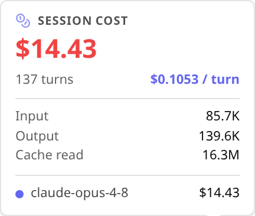
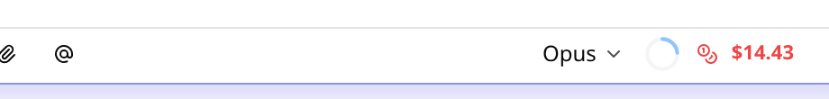
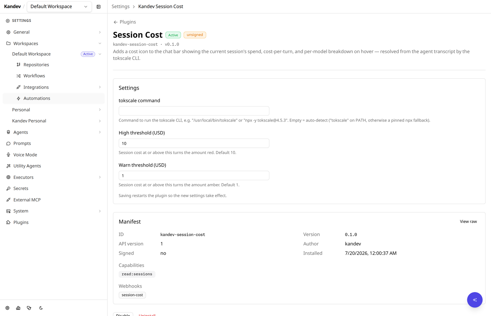

# Session Cost

A [Kandev](https://github.com/kdlbs/kandev) plugin that shows the current
session's spend, cost per turn, and per-model usage in the chat composer. The
backend reads the local agent transcript through the [tokscale](https://github.com/junhoyeo/tokscale)
CLI.

## Screenshots

Session cost details on hover or focus, with the total, cost per turn, token
totals, and per-model breakdown:



The action appears in the chat composer toolbar:



Settings are generated from `manifest.yaml`:



## Behavior

- The action registers once in `chat-input-actions`. Hover or keyboard focus
  starts one request for the active session. Click or tap pins the details open.
- The accessible action label stays “Session cost” when the displayed amount
  changes. On hosts with `host.ui.Action`, the host owns the action's size,
  spacing, focus style, and icon box. Hosts without Action use the plugin's
  existing Button fallback.
- Pinned details show the total, cost per turn, input/output/cache-read token
  totals, and per-model costs and token counts. Click or tap the action again,
  click outside, or press Escape to close them.
- Refresh is available while details are pinned. It recalculates the active
  session once and remains disabled until the request finishes.
- The backend uses one report worker for all sessions. A new lookup returns a
  progress state while tokscale scans transcripts. The backend keeps the last
  successful report in memory for 30 seconds.
- While a report runs, details keep the last successful cost and mark it as a
  previous result. A report or request error shows translated recovery text and
  a retry action.
- The browser requests status every two seconds while details stay open. It
  stops polling after 130 seconds. Each request has a 10-second timeout.
- The backend stops its report worker and child processes when the plugin stops.
  It does not start a report when the active session has no ACP transcript.
- The total changes from green to amber at `warn_threshold` and to red at
  `high_threshold`.
- The backend maps the Kandev session ID to the agent transcript ID. The UI
  sends only Kandev task and session IDs.
- If tokscale is unavailable, the details explain how to configure its command.

The action label and details are registered with Kandev's plugin translation
API. English is the fallback; Portuguese (Portugal) is also included.

## Requirements and permissions

The manifest uses plugin API v1 and requests read-only access to Kandev
sessions (`api_read: ["sessions"]`). It does not request credentials or write
access. The plugin runs tokscale on the machine hosting the Kandev plugin
backend, so tokscale must be installed there or available through the configured
command.

The package contains server binaries for Linux amd64 and arm64, macOS amd64 and
arm64, and Windows amd64. The UI uses the host's React instance and does not
bundle a second React runtime.

The backend uses the public Go SDK
`github.com/kdlbs/kandev/pluginsdk v0.1.0`. Its installed `sdk-release.json`
declares host release and minimum Kandev version **0.99.0**, with API versions
1 and 2. This package keeps API v1 and declares that SDK-wide host floor in
`manifest.yaml`. SDK versions are independent of plugin and Kandev versions.
Previously installed plugin binaries keep their existing compatibility; this
source migration raises the declared floor for newly built packages.

The UI is a committed JavaScript bundle with no npm SDK dependency or lockfile.
It uses the host's React and registry API directly, detects `host.ui.Action`,
and retains its existing Button fallback.

## Settings

Open **Settings → Plugins → Session Cost**:

- `command` sets the tokscale command or path. Empty uses `tokscale` from PATH,
  then the pinned `npx -y tokscale@4.15.1` fallback.
- `warn_threshold` is the USD amount at which the displayed total turns amber.
  Its default is 1.
- `high_threshold` is the USD amount at which the displayed total turns red.
  Its default is 10.

## Install

Download the package from a GitHub Release and upload it in **Settings →
Plugins → Install plugin**. You can also install the local package through the
plugin API:

```sh
curl -F package=@kandev-session-cost-0.4.1.tar.gz http://localhost:8080/api/plugins/install
```

## Develop and verify

Use Go 1.26 and Node.js 24. SDK compilation, tests, and compatibility checks
resolve the public module without a Kandev sibling checkout:

```sh
go mod download
make sdk-check
```

Keep the exact Go SDK pin and upgrade it deliberately. After an upgrade, run
`go mod tidy`, inspect the installed SDK's `sdk-release.json`, update the
manifest floor if needed, and rerun compatibility, tests, packages, and the
minimum-host smoke. If a frontend SDK dependency is introduced, use the matching
exact `@kdlbs/plugin-sdk` version and pass its installed path to the checker.

Packaging still needs backend-owned `plugin-pack`. `.kandev-pack-ref` pins its
source separately from the public SDK. Create a task-owned tooling checkout
(the root `pluginsdk/` directory is required by the backend module):

```sh
git clone --filter=blob:none --sparse https://github.com/kdlbs/kandev.git /tmp/session-cost-pack-tools
git -C /tmp/session-cost-pack-tools sparse-checkout set apps/backend pluginsdk
git -C /tmp/session-cost-pack-tools checkout --detach "$(cat .kandev-pack-ref)"
export KANDEV_PACK_ROOT=/tmp/session-cost-pack-tools
```

`KANDEV_PACK_ROOT` defaults to `../kandev` for existing packaging layouts. It
must point to the tested tooling revision. Public SDK resolution does not make
packaging checkout-free.

Run the local checks from the plugin root:

```sh
make sdk-check
make check-format
go mod tidy
git diff --exit-code -- go.mod go.sum
make vet
make test
make build
make package-host
make package
make verify-package-host
make verify-package
```

`make test` runs the Go suite, UI bundle behavior tests, JavaScript syntax
check, and negative package/release verifier tests. `make verify-package-host`
checks the package for the current machine. `make verify-package` builds and
checks all five declared platforms, the UI bundle, manifest identity, exact
file inventory, and checksums. `make package-host` and `make package` create
the corresponding archives without the additional verification step.

The UI has no build step or npm dependencies. The UI bundle unit tests use
mocked fetch responses. They do not run tokscale or read an agent database.

## Packaged browser smoke test

Build the disposable Kandev host and its E2E fixture package:

```sh
PLUGIN_ROOT=$PWD
HOST_ROOT=$PLUGIN_ROOT/../kandev
(cd "$HOST_ROOT" && make build-backend build-web-e2e build-e2e-plugin-package build-e2e-delivery-fixture build-e2e-send-now-fixture)
(cd "$HOST_ROOT/apps" && pnpm install --frozen-lockfile)
```

Run both desktop and phone checks against the package.

The tests install the archive through the host UI. Each test uses a temporary
tokscale command. The command blocks, returns fixture data, and fails once.
The browser calls the installed webhook and checks its recovery states.

```sh
(cd "$HOST_ROOT/apps/web" && \
  NODE_OPTIONS='--import=tsx' \
  SESSION_COST_PACKAGE_PATH="$PLUGIN_ROOT/kandev-session-cost-0.4.1.tar.gz" \
  SESSION_COST_EXPECT_ACTION=1 \
  pnpm exec playwright test --config "$PLUGIN_ROOT/test/host-action-smoke.playwright.config.mjs")
```

Set `KANDEV_HOST_ROOT` to the disposable source checkout at the declared
minimum host. Older host/fallback checks from previous plugin releases do not
establish support below this package's declared floor.

The minimum-host release check uses this same package against Kandev `v0.99.0`
([release](https://github.com/kdlbs/kandev/releases/tag/v0.99.0), source commit
`f0e2e774cfe2df8a0d15e4c21dea7b48580e38fb`). Verify the published Linux x64
full-runtime archive with its `.sha256` file. Set `PLUGIN_ROOT` to this
checkout, `HOST_ROOT` to a source checkout at that exact commit, `TASK_TMP` to
a short task-owned temporary directory, and `E2E_RUNTIME` to a subdirectory of
`TASK_TMP`. Build the release source's E2E web assets and `mock-agent` fixture
(`pnpm install --frozen-lockfile`, `make build-web-e2e`,
`make build-e2e-plugin-package build-e2e-delivery-fixture build-e2e-send-now-fixture`,
and `make -C apps/backend build-mock-agent`). `agentctl` looks for `mock-agent`
beside the runtime executable, so copy the verified runtime to a disposable
directory and add that fixture beside it; do not modify the downloaded
release archive. For example:

```sh
mkdir -p "$TASK_TMP" "$E2E_RUNTIME"
tar -xzf /path/to/kandev-linux-x64-full.tar.gz -C "$TASK_TMP"
cp -a "$TASK_TMP/kandev/." "$E2E_RUNTIME/"
cp "$HOST_ROOT/apps/backend/bin/mock-agent" "$E2E_RUNTIME/bin/mock-agent"
chmod +x "$E2E_RUNTIME/bin/mock-agent"
```

Set `KANDEV_E2E_BIN` to `$E2E_RUNTIME/bin/kandev` and `KANDEV_HOST_ROOT` to
`$HOST_ROOT`. Put `$E2E_RUNTIME/bin` first on `PATH`. Use isolated `HOME`, XDG
data/config/cache directories, `TMPDIR`, and Playwright port offsets. Start
from a sanitized environment so inherited `KANDEV_BUNDLE_DIR`, `KANDEV_VERSION`,
or service configuration cannot select another installed host. Bind to loopback
and require `/health` to report the expected release. Run the two projects
separately with `--workers=1`:

```sh
mkdir -p "$TASK_TMP/home" "$TASK_TMP/config" "$TASK_TMP/data" \
  "$TASK_TMP/cache" "$TASK_TMP/tmp" "$TASK_TMP/artifacts"

env -i LANG=C.UTF-8 HOME="$TASK_TMP/home" XDG_CONFIG_HOME="$TASK_TMP/config" \
  XDG_DATA_HOME="$TASK_TMP/data" XDG_CACHE_HOME="$TASK_TMP/cache" \
  TMPDIR="$TASK_TMP/tmp" PATH="$E2E_RUNTIME/bin:$PATH" \
  NODE_OPTIONS='--import=tsx' KANDEV_HOST_ROOT="$HOST_ROOT" \
  KANDEV_E2E_BIN="$E2E_RUNTIME/bin/kandev" \
  SESSION_COST_SMOKE_ARTIFACT_DIR="$TASK_TMP/artifacts" \
  SESSION_COST_PACKAGE_PATH="$PLUGIN_ROOT/kandev-session-cost-0.4.1.tar.gz" \
  SESSION_COST_EXPECT_ACTION=1 SESSION_COST_EXPECT_HOST_VERSION=0.99.0 \
  KANDEV_SERVER_HOST=127.0.0.1 E2E_PORT_OFFSET=22 \
  pnpm exec playwright test --config "$PLUGIN_ROOT/test/host-action-smoke.playwright.config.mjs" \
    --project=chromium --workers=1 --retries=0

# Repeat with E2E_PORT_OFFSET=23 and --project=mobile-chrome.
```

Each run records its `/health` response, and each successful run attaches and
saves a task-composer screenshot under `$TASK_TMP/artifacts`. On NixOS, pass the
required browser runtime library paths into the sanitized child environment.

## CI and releases

Pull requests check module tidiness, Go formatting, vet, Go and UI tests, and
both host-only and full platform packages. SDK compilation and tests use the
public Go module without a host checkout.
Build and release workflows retain a packaging-only checkout pinned by
`.kandev-pack-ref`, including `apps/backend` and root `pluginsdk/`.
`make sdk-check` runs the installed-dependency compatibility checker before
build/package. Node is set up explicitly for the UI tests.

Release automation runs from `main`. Select a patch, minor, or major bump, then
use its dry run before a release. The workflow builds and validates the proposed
version before it pushes release metadata or a tag. A pushed tag must match the
manifest, Makefile, and packaged manifest before the workflow publishes a
GitHub Release with the archive and `checksums.txt`.

See [SDK migration validation](docs/sdk-migration-validation.md) for current
standalone, packaging, and minimum-host smoke evidence. No plugin release or
catalog change is part of this migration.

## License

See [LICENSE](LICENSE).
